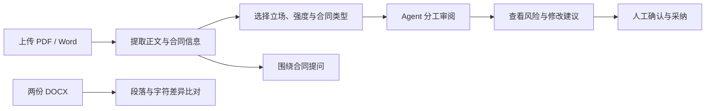
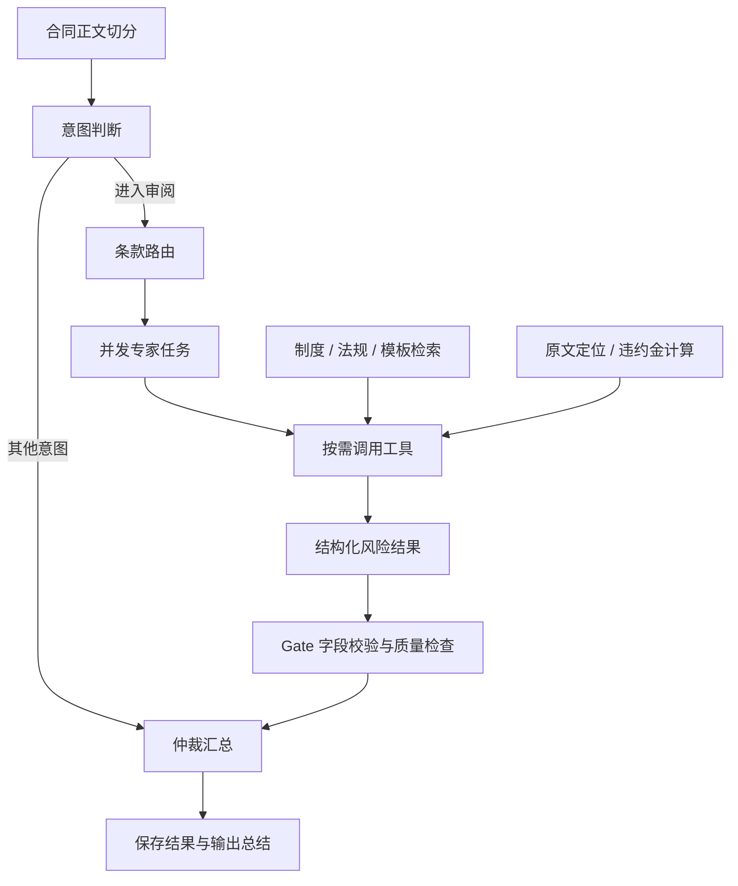
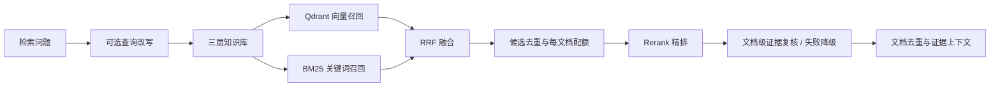

# Contract Review · 采购合同智能审阅平台

[](https://github.com/yskkkk3/Contract_Review/actions/workflows/ci.yml)


**把合同原文、风险判断和修改建议放进同一个工作流。**

Contract Review 面向高校采购合同场景，将文档解析、分工审阅、知识检索与人工确认连接起来。用户可以上传合同、设置审阅立场与强度，查看逐步返回的风险分析，也可以对照两份合同的变化，或围绕合同内容继续提问。

当前版本采用 **DeepSeek 推理 + 阿里云百炼向量化 / 重排 / 可选 OCR** 的组合，业务数据存入 MySQL，文件可保存在本地或阿里云 OSS。模型、存储和解析引擎均通过配置切换。

[开始运行](#本地运行) · [审阅如何工作](#审阅如何工作) · [配置说明](#按能力配置服务) · [开发文档](#继续阅读)

## 从一份合同开始



| 工作入口 | 可以完成的事情 |
| --- | --- |
| 合同管理 | 上传 PDF、DOCX、DOC，解析正文并提取甲乙方、金额；查看、下载和删除文件 |
| 智能审阅 | 根据合同类型、审阅立场和强度生成风险点，展示原文摘录、风险等级、分析和建议文本，记录采纳状态 |
| 合同比对 | 对两份 DOCX 做段落对齐和字符级差异展示，识别新增、删除与替换 |
| 智能问答 | 将合同正文节选与会话历史作为上下文，流式回答后续问题 |
| 工作台 | 查看合同审阅概况、审阅趋势和修改采纳统计 |
| 系统配置 | 管理合同类型、专家提示词和模型参数 |
| 账户与界面 | 注册登录、用户头像上传与重置；统一的设计变量、组件和响应式导航 |

头像支持本地或 OSS 存储，上传上限为 **5 MB**，经图片校验后统一处理为 WebP。前端另提供 `/design-system.html`，用于查看设计系统与交互示例。

## 审阅如何工作

审阅任务在 LangGraph 状态机中经过分发、分析、校验和汇总。专家任务按照“条款 × 风险维度”展开，并受并发上限控制。



六类审阅视角分别覆盖：

| 维度 | 关注的问题举例 |
| --- | --- |
| 主体资格与合规 | 签约主体、供应商资格、采购程序 |
| 财务与付款 | 付款前提、支付节点、保证金安排 |
| 知识产权与保密 | 成果归属、使用权限、保密义务 |
| 违约责任与解除 | 责任分配、逾期处理、解约条件 |
| 验收交付与质保 | 交付标准、验收程序、售后责任 |
| 争议解决与管辖 | 争议处理路径、管辖约定 |

专家可以调用四个工具：**知识查证、条款原文读取、违约金试算、模板查询**。计算由确定性代码执行，检索结果回传给模型；工具循环设置轮次上限与结果长度限制，异常也会回传给模型处理。提示词保存在独立 Markdown 文件中，便于调整审阅策略。

模型输出经过字段归一化、关键依据完整性复核和 Gate 校验，再进入仲裁汇总。SSE 通道先返回任务信息，随后推送已通过质检的意见与最终总结；核验失败或关键依据缺失时显示“审阅待补查”。

## 让判断有据可查

审阅知识库分为校内采购制度、采购相关法规和合同模板三层，仓库目前包含 **65 篇本地文本语料**。已核对的法规摘要带官方来源、版本、生效日期和适用范围；2026-10-16 隔离重建保留5篇公开学校页面，共70篇、486个分块，实际数量随采集及重建结果变化。未标注版本的旧资料仍须核实。

审阅会针对21组主题补查关键条文、适用条件与例外，目前维护53项依据核对项和35个结论敏感场景。实际索引资料展示检查通过。当前按仅使用DeepSeek Flash的配置进行独立真实验收；此前Pro配置的结果仅作为历史记录，不能替代Flash成绩，见 [此前验收记录](docs/legal-acceptance-2026-10-16.md)。



- 向量召回负责语义匹配，BM25 保留术语和关键词匹配能力。
- 每篇文档进入精排的片段数量受限，最终结果再按文档去重，减少单一材料占满结果列表的情况。
- 跨查询命中融合排名，三个库复用查询向量；精排后对最多30篇候选文档复核实际支持程度，超时或无效排序回退精排结果，可通过配置关闭。
- `ingest_kb.py` 同时构建 Qdrant 向量索引与 BM25 索引；更换向量模型或维度后需要重建。
- 内置 **120 条 Golden Set**，支持检索指标检查；RAGAS 生成质量评估和真实模型冒烟测试单独运行。

测评与压测报告保留各自的测试条件。更换模型、语料或部署环境后，应重新测量，历史结果不作为当前配置的性能承诺。
本轮同查询成对评测及正式门禁独立复测均通过原阈值，配置、成本和隔离索引限制见 [2026-10-15 检索优化报告](docs/rag-optimization-2026-10-15.md)。

## 系统组成

| 部分 | 实现与职责 |
| --- | --- |
| Web 应用 | Vue 3、TypeScript、Vite、Element Plus、Pinia、ECharts |
| API 与数据 | FastAPI、Pydantic v2、SQLAlchemy 2、MySQL、JWT |
| Agent | LangGraph 状态编排、专家任务、工具调用、输出校验、规则降级 |
| 检索 | Qdrant、BM25、jieba、RRF、查询改写、Rerank |
| 模型接入 | 推理与 Embedding 使用 OpenAI SDK；Rerank 使用兼容 HTTP 接口 |
| 文档与文件 | PDF / Word 多引擎解析、可选千问 OCR、本地存储 / 阿里云 OSS |
| 运行支撑 | Redis 缓存与锁、请求日志、延迟指标、可选 Langfuse、MCP 工具入口 |
| 开发交付 | uv、npm、pytest、Ruff、Docker Compose、GitHub Actions |

推理、向量化、精排和 OCR 的配置相互独立。当前模板使用 `text-embedding-v4`（1024 维）、`qwen3-rerank` 和 `qwen3.5-ocr`；审阅、聊天、意图识别分别配置模型名称。

## 本地运行

推荐 **Python 3.12 + uv + Node.js 22 + MySQL + Redis + Qdrant**。以下命令在项目根目录的 PowerShell 中开始执行。

### 1. 获取代码与依赖

```powershell
git clone https://github.com/yskkkk3/Contract_Review.git
cd Contract_Review
Copy-Item backend/.env.example .env

cd backend
uv sync --frozen
cd ../frontend
npm ci
cd ..
```

### 2. 填写根目录配置

编辑 `.env`，填写数据库、Redis、Qdrant 和模型凭据。模板中的 `mysql`、`redis`、`qdrant` 是容器服务名；本机启动时需要改成实际可访问的主机地址。

下面是本地服务的配置示例，密钥另行填写：

```dotenv
MYSQL_HOST=127.0.0.1
MYSQL_PORT=3306
MYSQL_DB=contract_review
DATABASE_URL=

REDIS_HOST=127.0.0.1
REDIS_PORT=6379
REDIS_FAKE=false

QDRANT_HOST=127.0.0.1
QDRANT_PORT=6333
QDRANT_LOCATION=

STORAGE_BACKEND=local
UPLOAD_DIR=./data/uploads
OSS_BUCKET_DIR=./data/parsed
```

先创建 MySQL 数据库，并填写对应的 `MYSQL_USER`、`MYSQL_PASSWORD`。运行时工作目录为 `backend/`，上面的相对存储路径也据此解析。`DATABASE_URL` 留空时使用 `MYSQL_*` 配置；JWT 密钥使用自行生成的随机字符串。

### 3. 构建知识库

确认 Qdrant 可访问，且 Embedding 凭据已填写：

```powershell
cd backend
uv run python scripts/ingest_kb.py
```

此步骤会调用向量模型，将语料写入 Qdrant，并在本地生成 `kb_bm25.pkl`。生成的索引不随源码提交，首次部署需要自行构建。

### 4. 启动前后端

打开两个终端：

```powershell
# 终端一：后端，工作目录 backend/
uv run python run_dev.py
```

```powershell
# 终端二：前端，工作目录 frontend/
npm run dev
```

| 地址 | 用途 |
| --- | --- |
| `http://localhost:5173` | 应用入口 |
| `http://127.0.0.1:8080/docs` | API 文档 |
| `http://127.0.0.1:8080/health` | 后端健康检查 |
| `http://localhost:5173/design-system.html` | 设计系统示例 |

### 在 PyCharm / IDEA 中运行

将 Python 解释器设为 `backend/.venv/Scripts/python.exe`，后端脚本选 `backend/run_dev.py`，工作目录设为 `backend/`；前端使用 `frontend/package.json` 中的 `dev` 脚本。

仓库的 `.run/` 包含 `Backend (FastAPI)`、`Frontend (Vue)` 和 `Full Stack` 配置。首次导入时检查 Python 与 Node.js 的本机路径；组合启动需要 IDE 支持相应的运行配置。

Qdrant 部署在远端且只监听回环地址时，可以先建立 SSH 隧道，再启动应用：

```powershell
ssh -N -o ExitOnForwardFailure=yes -L 127.0.0.1:6333:127.0.0.1:6333 <ssh-user>@<vm-host>
```

隧道保持运行，应用的 `QDRANT_HOST` 设置为 `127.0.0.1`。已有的 `Qdrant SSH Tunnel` 配置需按自己的环境调整连接地址。

## 按能力配置服务

| 能力 | 关键配置 | 使用说明 |
| --- | --- | --- |
| 审阅与问答 | `LLM_BASE_URL`、`LLM_API_KEY`、`LLM_REVIEW_MODEL`、`LLM_CHAT_MODEL`、`LLM_INTENT_MODEL` | 默认使用 DeepSeek Flash，模型名按账户可用型号填写 |
| 模型成本限制 | `LLM_ALLOWED_MODELS` | 可选逗号分隔白名单；示例仅允许 Flash，切换模型ID时同步修改；仅限制推理，百炼向量和精排独立配置 |
| 向量索引 | `EMBEDDING_BASE_URL`、`EMBEDDING_API_KEY`、`EMBEDDING_MODEL`、`EMBEDDING_DIMENSIONS` | 模型维度应与 Qdrant 集合一致 |
| 检索精排 | `RERANK_URL`、`RERANK_API_KEY`、`RERANK_MODEL` | URL 填写完整重排接口地址 |
| 云端 OCR | `OCR_BASE_URL`、`OCR_API_KEY`、`OCR_MODEL`、`OCR_MAX_PAGES` | 在 `DOC_PARSER_ENGINES` 中显式加入 `cloud_ocr`；Key 留空时可复用百炼 `EMBEDDING_API_KEY` |
| OSS 文件存储 | `STORAGE_BACKEND=oss`、`OSS_ENDPOINT`、`OSS_BUCKET_NAME`、`OSS_ACCESS_KEY_ID`、`OSS_ACCESS_KEY_SECRET` | Endpoint 按 Bucket 所在地域填写；原始文件、解析文本与头像经统一存储层读写 |
| 观测与外部工具 | `LANGFUSE_*`、`MCP_ENABLED`、`MCP_SERVER_URLS` | 按需配置，日常本地启动可先不启用 |

云端 OCR 会将待识别页面发送至模型服务；只有在接受这种处理方式时才启用。DOC 转换依赖 LibreOffice，本地 OCR 依赖 Tesseract 及相关 PDF 工具；未安装这些组件时，按实际环境调整解析引擎列表。

所有真实凭据只保存在本地 `.env`，该文件已被 Git 忽略。公开示例仅用于说明配置结构。

## 容器运行

配置好根目录 `.env` 后：

```bash
docker compose -f deploy/docker-compose.yml up -d --build
docker compose -f deploy/docker-compose.yml exec backend python scripts/ingest_kb.py
```

Compose 编排 MySQL、Redis、Qdrant、后端、前端，以及 Langfuse 和其 PostgreSQL 数据库。前端入口为 `http://localhost`，Langfuse 入口为 `http://localhost:13000`。

这是本地联调部署配置；其中的示例数据库口令、JWT 和 Langfuse 参数应在部署到自己的环境前配置好。CI 中的部署步骤目前为占位入口。

## 开发与验证

后端依赖由 `pyproject.toml` 和 `uv.lock` 管理，新增依赖使用 `uv add`；前端使用 npm 与 `package-lock.json`。

```powershell
# 工作目录 backend/
uv run ruff check app tests scripts
uv run pytest tests -q
uv run python scripts/check_golden.py

# 工作目录 frontend/
npm run build
```

常规测试通过 mock 模型与测试存储运行，不需要真实 API Key。GitHub Actions 执行后端规范检查、测试、前端构建、镜像构建与 Golden Set 静态门禁；完整检索指标门禁按工作流中的 Secret 条件启用。

真实服务验证按需单独执行：

```powershell
# 工作目录 backend/；需要相应模型凭据与服务
uv run python scripts/smoke_agent.py
uv run --extra eval python scripts/eval_rag.py
uv run --extra eval python scripts/eval_ragas.py --cases 10
```

`make` 可用的环境也可以通过根目录 Makefile 执行这些任务。

## 代码从哪里看

```text
backend/
  app/agent/       状态机、专家节点、工具、提示词与规则降级
  app/rag/         知识库构建、混合检索、重排与评测
  app/api/         账户、合同、会话、审阅、比对与管理接口
  app/services/    文档解析、审阅流、对话流与头像处理
  app/core/        配置、数据库、Redis、Qdrant、存储与指标
  app/mcp/         对外工具服务与客户端入口
  tests/           单元测试与接口测试
  scripts/         知识库、质量门禁、冒烟与压测命令
frontend/
  src/views/       工作台、合同、审阅、比对、问答与配置页面
  src/components/  业务组件、应用导航与基础 UI 组件
  src/styles/      设计变量、排版与全局样式
.run/              JetBrains IDE 运行配置
deploy/            Compose 部署配置
docs/              设计、运行指南、评测与压测记录
```

## 继续阅读

- [设计说明](docs/DESIGN.md)：系统分层、Agent 编排与数据结构。
- [运行指南](docs/QUICKSTART.md)：环境准备、常用命令与排查步骤。
- [检索评测记录](docs/rag-eval.md)：指标口径、语料标注与评测方法。
- [性能测试记录](docs/benchmark.md)：测试场景与延迟指标。
- [工具与流式设计](docs/design-tool-calling-and-ttft.md)：工具调用与首 Token 计时。
- [仓库协作指南](AGENTS.md)：修改代码时的约定。

维护：[yskkkk3](https://github.com/yskkkk3)
